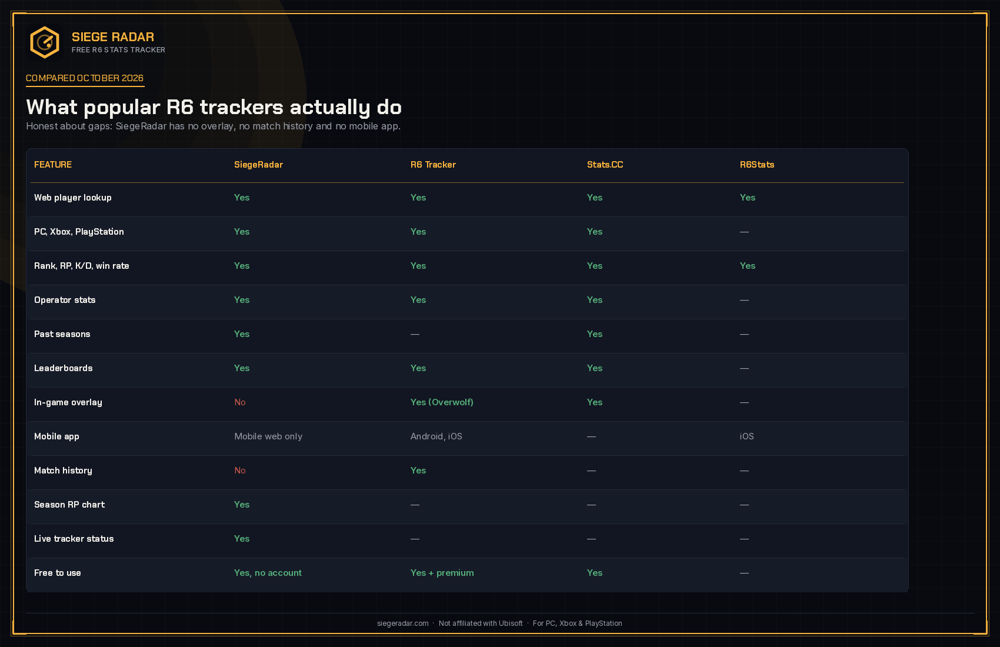
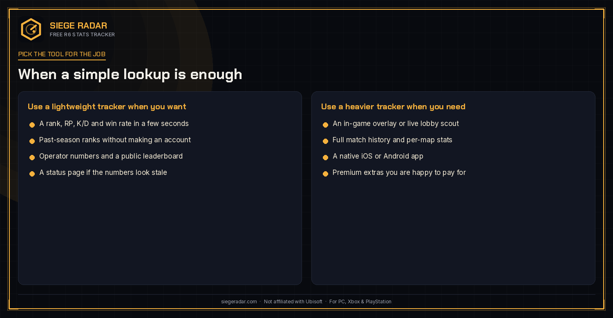

# Comparing Rainbow Six Siege Stat Trackers in 2026

**Website:** https://siegeradar.com

An honest comparison of the main Rainbow Six Siege stat trackers, including the gaps in the one we run. Last checked against public feature lists in October 2026.

SiegeRadar is a free, unofficial tracker and is not affiliated with Ubisoft. For the game itself, see the [official Rainbow Six Siege site](https://www.ubisoft.com/en-us/game/rainbow-six/siege), the [Steam store page](https://store.steampowered.com/app/359550/Tom_Clancys_Rainbow_Six_Siege/) and [Wikipedia's overview](https://en.wikipedia.org/wiki/Tom_Clancy%27s_Rainbow_Six_Siege).

## Why "best" is the wrong first question

Players usually want one of three things from a tracker:

1. A fast lookup of rank, RP, K/D and win rate for a player on PC, Xbox or PlayStation.
2. A deeper scouting tool: live overlay, match history, per-map stats, a mobile app.
3. A way to compare past seasons and operators without making an account.

No popular tracker is equally good at all three. If you start with "which is best?" you end up arguing about a feature you do not use. If you start with the job, the field narrows quickly.

## Feature comparison

The table below is based on each tracker's own website and app-store listings, checked in October 2026. A dash means the feature was not clearly offered on those pages at the time. Treat it as a snapshot, not a permanent scorecard.

A few lines are worth reading twice.

**Platforms.** A web lookup on PC, Xbox and PlayStation is now table stakes for most of the field. If a tool only documents one platform, check before you send a console teammate a link.

**Past seasons.** This is the quiet differentiator. Some trackers show a rich live view and almost nothing about last season's rank. Others keep the season history and skip the overlay.

**Overlays and match history.** R6 Tracker (the Tracker Network / TRN product, with an Overwolf app) and Stats.CC both offer in-game overlays. That is a real advantage if you are scouting a lobby. SiegeRadar does not have an overlay, and it does not have match history. Those are genuine gaps, not footnotes.

**Mobile.** If you want a native iOS or Android app, look at the trackers that ship one. A mobile website is not the same thing.

**Price.** Several tools are free to look up a player. Some add a premium tier. SiegeRadar is free and does not require an account. That is convenient; it is not an argument that the paid extras elsewhere are worthless.

## When a lightweight tracker is enough

Use a simpler website when you want a rank and a season card in a few seconds, when you want operator numbers and past-season ranks without installing a desktop overlay, or when you just need to confirm a teammate's platform and RP before a stack. A public status page is also useful on evenings when the numbers look stale: sometimes the tracker is behind, and it is better that the page says so.

## When you should pick a heavier tool

Choose a tracker with an overlay if you regularly scout live lobbies. Choose one with match history if you review individual games after a session. Choose one with a native app if you mostly check stats on a phone and dislike a mobile browser. None of those jobs is lesser. They are just different products.

It is reasonable to keep two bookmarks. Many players already do: one for a quick profile, one for the overlay they run during a session.

## How to read any comparison, including this one

A few cautions, because we have a conflict of interest and should say so.

- Feature lists go stale. Re-check the live sites before you commit to a tool for a season.
- "Yes" does not mean "the same." Two operator pages can show different sample windows. Two win rates can use different denominators.
- Popularity is not accuracy. A well-known name can still cache aggressively or hide a denominator.
- Gaps should be named. A tracker that cannot show match history should not imply that it can.

If you want the longer, regularly updated version of this comparison, including the same caveats, use the public page below as a starting point, then click through to each product and see whether it does the job you actually have.

## Further reading

- The [best R6 trackers](https://siegeradar.com/best-r6-trackers) comparison page (updated as features change)
- [Official Rainbow Six Siege](https://www.ubisoft.com/en-us/game/rainbow-six/siege)
- [Steam: Tom Clancy's Rainbow Six Siege](https://store.steampowered.com/app/359550/Tom_Clancys_Rainbow_Six_Siege/)
- [Wikipedia: Tom Clancy's Rainbow Six Siege](https://en.wikipedia.org/wiki/Tom_Clancy%27s_Rainbow_Six_Siege)
